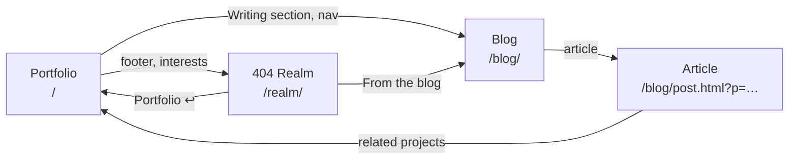

# ZEROBYTE57.github.io

Personal site of **Devisetty Lakshmi Srinivas**, AI Engineer and Data Scientist (M.Tech AI & ML, Amrita Vishwa Vidyapeetham).

**Live:** [Portfolio](https://zerobyte57.github.io/) · [Blog](https://zerobyte57.github.io/blog/) · [404 Realm](https://zerobyte57.github.io/realm/)

The site has three connected parts: a formal **portfolio**, a **blog** that shares its design, and **404 Realm**, an informal gaming page with its own look.



---

## Portfolio `/`

A single page with light and dark themes, read top to bottom:

| # | Section | What it shows |
| --- | --- | --- |
| – | **Intro** | Name, role, summary, resume download, live Bengaluru clock, education tile |
| 01 | **About** | Background, education timeline, and a five-step "How I work" pipeline (Data → Explore → Model → Evaluate → Explain) |
| 02 | **Projects** | CXB dissertation, SMOTE multi-view CNN, LLM preference prediction, YOLOv3 road detection |
| 03 | **Skills** | Languages, ML/DL, methods, data science, tools, core CS |
| 04 | **Coding activity** | **Live:** GitHub contributions heatmap and recent repos, LeetCode, GeeksforGeeks, HackerRank |
| 05 | **Technical interests** | Linux (Fedora), game development, programming, algorithms, web development |
| 06 | **Achievements** | Certifications, TCS CodeVita rank, notes and reports |
| 07 | **Writing** | The three latest blog articles |
| 08 | **Contact** | Email, LinkedIn, GitHub, Discord, resume |

## Blog `/blog/`

Articles in the portfolio's design, so the two read as one site.

- **Knowledge graph:** an Obsidian-style map at the top linking **articles**, **topics** and **portfolio projects**. Drag nodes, scroll to zoom, hover to highlight neighbors, and click to open an article, filter by a topic or jump to a project.
- **Article list:** searchable, with topic filters.
- **Article page:** Markdown with `[[wikilinks]]` between articles and projects, plus a **local graph**, **related projects** and **linked mentions** (backlinks) in the sidebar.

## 404 Realm `/realm/`

The off-duty side, styled like an esports broadcast in ROG red and black: a scorebug header, a live ticker and a player card.

| # | Section | What it shows |
| --- | --- | --- |
| – | **Player intro** | Gamer tag, player card, headline stats |
| 01 | **Live now** | Personal Discord status (game, Spotify) and the 404 Realm server: members online, who is playing what, voice channels |
| 02 | **Season stats** | Steam profile and recent games, Tracker Network cards, a playtime leaderboard and the game library |
| 03 | **Loadout & rig** | Gamer handles and the full setup: ASUS ROG Strix G16, peripherals, Fedora with a custom CachyOS kernel |
| 04 | **Career mode** | M.Tech progress bar and live coding stats |
| 05 | **From the blog** | Latest articles |

---

## Where the live data comes from

| Data | Shown on | Source | Refresh |
| --- | --- | --- | --- |
| GitHub, LeetCode | Portfolio, Realm | Public APIs, in the browser | Every visit |
| GeeksforGeeks, HackerRank | Portfolio, Realm | `data/stats.json` | Every 6 h (GitHub Action) |
| Discord server | Realm | Discord widget and invite API, in the browser | Every visit, then every minute |
| Discord status | Realm | [Lanyard](https://github.com/Phineas/lanyard), in the browser | Every visit, then every minute |
| Steam profile and recent games | Realm | Public Steam profile → `data/gaming.json` | Every 6 h (GitHub Action) |
| Steam playtime and library | Realm | Steam client export → `data/steam_library.json` | When re-exported |
| Tracker Network | Realm | `data/gaming.json` | Every 6 h (GitHub Action) |
| Blog articles | Blog, Portfolio, Realm | `blog/posts/index.json` | On every new post (GitHub Action) |

## How it's built

Plain HTML, CSS and JavaScript with no framework and no build step, served by GitHub Pages.

```text
/                    portfolio (index.html, styles.css, script.js, live.js)
├── blog/            blog pages, graph engine, posts/*.md, projects.json
├── realm/           gaming page and its config.js
├── data/            profiles.json (usernames) and generated stats snapshots
├── scripts/         Python fetchers and the blog index builder
└── .github/workflows/
    ├── update-stats.yml   coding + gaming stats, every 6 h
    └── build-posts.yml    rebuilds the blog index when a post changes
```

## Keeping it fresh

| Task | How |
| --- | --- |
| Publish an article | Copy `blog/posts/_template.md`, write it, push |
| Refresh Steam playtime | `python scripts/steam_local.py` on a PC signed in to Steam, then push |
| Preview locally | `python -m http.server 8000`, then open `http://localhost:8000` |
