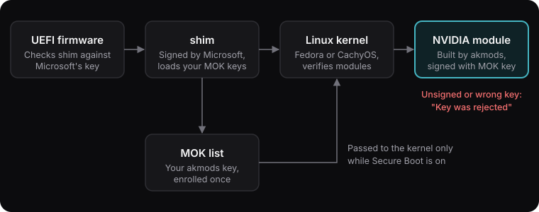

<!-- markdownlint-disable MD014 -- "$ " prompts drive the terminal styling in blog.js -->

The CachyOS kernel brings the BORE scheduler, a 1000 Hz tick, the ADIOS I/O scheduler and a set of performance patches to Fedora. Installing it takes two commands. Keeping **Secure Boot** on while the NVIDIA driver still loads is the part that takes care.

I have run this setup since March 2026 on my ASUS ROG Strix G16 (i7-13650HX, RTX 4060 Laptop), first on Fedora 43 and then on Fedora 44. The machine itself is described in [[fedora-on-rog-strix-g16]]. This guide goes from a stock Fedora install to:

- Secure Boot still **on**.
- The CachyOS kernel as the default, with Fedora's kernel kept as a fallback.
- The NVIDIA driver built for both kernels and signed with your own key, so it loads.

It follows on from [[schedulers-on-linux]], where the CachyOS kernel came up as an option. The command output below is from my laptop. Your versions and key names will differ.

## How the pieces fit

With Secure Boot on, every step of the boot has to be signed by a key the machine trusts:

1. The firmware trusts **shim**, which is signed by Microsoft.
2. shim trusts Fedora's key, **plus any key you enrol yourself**. That list is the MOK list (Machine Owner Keys).
3. The kernel trusts modules signed by those keys. shim only passes your MOK keys to the kernel **while Secure Boot is on**.



The NVIDIA driver is built on your own machine by `akmods`, so nothing has signed it yet. The fix is one key: create it, enrol it as a MOK, and akmods signs every NVIDIA build with it, for every kernel you install, CachyOS included.

> Every NVIDIA breakage I had came down to that chain: an unsigned module, a key that wasn't enrolled, or Secure Boot switched off.

## 1. Check the machine

The main CachyOS kernels need a CPU with **x86-64-v3** support (roughly Intel Haswell / AMD Zen and newer). The LTS and server kernels only need v2.

```bash
$ /lib64/ld-linux-x86-64.so.2 --help | grep "(supported, searched)"
  x86-64-v3 (supported, searched)
  x86-64-v2 (supported, searched)
```

Check that Secure Boot is on, and update before you start:

```bash
$ mokutil --sb-state
SecureBoot enabled
$ sudo dnf upgrade --refresh
$ sudo reboot
```

## 2. Create and enrol a signing key

```bash
$ sudo dnf install kmodtool akmods mokutil openssl
$ sudo kmodgenca -a
$ sudo mokutil --import /etc/pki/akmods/certs/public_key.der
input password:
input password again:
```

If `kmodgenca` says `EXISTING KEY PAIR`, you already have a key, so keep it. Don't run `kmodgenca --force` unless you plan to enrol the new key too, or akmods starts signing with a key the kernel doesn't trust. I ended up with five old akmods keys in my MOK list from doing exactly that. They are harmless, but avoidable.

Choose a short one-time password, then reboot:

```bash
$ sudo reboot
```

A blue **MOK Management** screen appears before Fedora starts. Pick **Enroll MOK**, then **Continue**, then **Yes**, type the password and reboot. The screen uses a US QWERTY layout and times out after a few seconds, so be ready.

Check the key is enrolled:

```bash
$ sudo mokutil --import /etc/pki/akmods/certs/public_key.der
SKIP: /etc/pki/akmods/certs/public_key.der is already enrolled
```

## 3. Install the NVIDIA driver on the stock kernel

Get the driver working on Fedora's kernel first. Then, if something breaks later, you know the problem is the new kernel, not the driver.

```bash
$ sudo dnf install https://mirrors.rpmfusion.org/free/fedora/rpmfusion-free-release-$(rpm -E %fedora).noarch.rpm
$ sudo dnf install https://mirrors.rpmfusion.org/nonfree/fedora/rpmfusion-nonfree-release-$(rpm -E %fedora).noarch.rpm
$ sudo dnf install akmod-nvidia xorg-x11-drv-nvidia xorg-x11-drv-nvidia-cuda
$ sudo dnf mark user akmod-nvidia
```

The `-cuda` package gives you `nvidia-smi`, CUDA, NVENC and NVDEC. The last line stops `dnf autoremove` from removing the driver.

The driver is now **building in the background**, which takes up to five minutes. Don't reboot until this prints a version:

```bash
$ modinfo -F version nvidia
595.71.05
$ modinfo -F signer nvidia
myhost_1700000000_a1b2c3d4
```

The signer should be your akmods key (akmods names it after your hostname, so yours will look different). Reboot and check:

```bash
$ sudo reboot
$ nvidia-smi --query-gpu=name,driver_version --format=csv
name, driver_version
NVIDIA GeForce RTX 4060 Laptop GPU, 595.71.05
```

## 4. Install the CachyOS kernel

Enable the COPR, let SELinux allow module loading, and install the kernel **with its matching devel package**. akmods needs the devel package to build NVIDIA for this kernel.

```bash
$ sudo dnf copr enable bieszczaders/kernel-cachyos
$ sudo setsebool -P domain_kernel_load_modules on
$ sudo dnf install kernel-cachyos kernel-cachyos-devel-matched
```

The same COPR has other builds:

| Package | What it is |
| --- | --- |
| `kernel-cachyos` | 1000 Hz, BORE. The one I use. |
| `kernel-cachyos-lts` | LTS base, BORE. Only needs x86-64-v2. |
| `kernel-cachyos-rt` | Real-time, BORE. For audio work. |
| `kernel-cachyos-server` | 300 Hz, stock EEVDF. Only needs x86-64-v2. |

There are also clang/ThinLTO builds in `bieszczaders/kernel-cachyos-lto`. I stick with the GCC build, since akmods builds external modules like NVIDIA with GCC by default.

CachyOS stopped shipping prebuilt NVIDIA modules with these kernels in early 2026, so the RPM Fusion driver from step 3 is the way to go.

While you are here, the add-ons COPR has the sched-ext schedulers and CachyOS's tuned sysctl defaults:

```bash
$ sudo dnf copr enable bieszczaders/kernel-cachyos-addons
$ sudo dnf install scx-scheds scx-tools
$ sudo dnf swap zram-generator-defaults cachyos-settings
$ sudo dracut -f
```

## 5. Check the kernel will boot under Secure Boot

Find the new kernel and look at its signature:

```bash
$ ls /boot | grep vmlinuz.*cachyos
vmlinuz-7.0.5-cachyos1.fc44.x86_64
$ sudo dnf install sbsigntools
$ sudo sbverify --list /boot/vmlinuz-7.0.5-cachyos1.fc44.x86_64
```

On my laptop, the COPR kernel booted with Secure Boot enforcing, with no extra steps, on both Fedora 43 and 44. I never pinned down how that image was signed, so check yours. If `sbverify` says `No signature table present`, or the boot later fails with `bad shim signature`, sign the kernel with your MOK key as described below.

### If the kernel isn't signed: sign it automatically

`sbsign` wants the certificate in PEM format, so convert it once:

```bash
$ sudo openssl x509 -inform DER -in /etc/pki/akmods/certs/public_key.der \
  -outform PEM -out /etc/pki/akmods/certs/public_key.pem
$ sudoedit /etc/kernel/install.d/99-sign-cachyos.install
```

```sh
# file: /etc/kernel/install.d/99-sign-cachyos.install
#!/bin/sh
# Sign CachyOS kernels with the akmods MOK key so shim will boot them.
COMMAND="$1"
KVER="$2"

[ "$COMMAND" = "add" ] || exit 0
case "$KVER" in *cachyos*) ;; *) exit 0 ;; esac

IMG="/boot/vmlinuz-$KVER"
KEY="/etc/pki/akmods/private/private_key.priv"
CERT="/etc/pki/akmods/certs/public_key.pem"

[ -f "$IMG" ] || exit 0
# Already signed with our key? Nothing to do.
sbverify --cert "$CERT" "$IMG" >/dev/null 2>&1 && exit 0

sbsign --key "$KEY" --cert "$CERT" --output "$IMG" "$IMG"
```

Make it executable, then run it once for the kernel you already installed:

```bash
$ sudo chmod +x /etc/kernel/install.d/99-sign-cachyos.install
$ sudo /etc/kernel/install.d/99-sign-cachyos.install add 7.0.5-cachyos1.fc44.x86_64
```

From now on it runs every time a CachyOS kernel is installed. It only touches kernels with `cachyos` in the version, so Fedora's kernels are left alone.

## 6. Build NVIDIA for the new kernel

akmods builds the driver when it sees a new kernel, but check before you reboot:

```bash
$ sudo akmods --force --kernels 7.0.5-cachyos1.fc44.x86_64
Checking kmods exist for 7.0.5-cachyos1.fc44.x86_64       [  OK  ]
$ modinfo -F version nvidia -k 7.0.5-cachyos1.fc44.x86_64
595.71.05
$ modinfo -F signer nvidia -k 7.0.5-cachyos1.fc44.x86_64
myhost_1700000000_a1b2c3d4
```

NVIDIA modules for the CachyOS and Fedora kernels sit side by side, so Fedora's kernel stays a working fallback.

## 7. Make it the default and reboot

```bash
$ sudo grubby --set-default /boot/vmlinuz-7.0.5-cachyos1.fc44.x86_64
$ sudo grubby --default-kernel
/boot/vmlinuz-7.0.5-cachyos1.fc44.x86_64
$ sudo reboot
```

Fedora usually makes the newest installed kernel the default, so a Fedora kernel update can switch you back. Run the `grubby` command again after updates, or use the dnf5 action from the [CachyOS COPR README](https://github.com/CachyOS/copr-linux-cachyos#default-kernel), which picks the newest CachyOS kernel after every kernel update.

## 8. Check everything works

```bash
$ uname -r
7.0.5-cachyos1.fc44.x86_64
$ mokutil --sb-state
SecureBoot enabled
$ nvidia-smi --query-gpu=name,driver_version --format=csv
name, driver_version
NVIDIA GeForce RTX 4060 Laptop GPU, 595.71.05
$ sudo dmesg | grep -i -E "bore|adios"
$ sudo dmesg | grep -i "key was rejected"
```

The BORE and ADIOS lines confirm you are on the CachyOS kernel. The last command should print nothing. Now you can pick a sched-ext scheduler, as described in [[schedulers-on-linux]].

## Updates and Fedora upgrades

Normal `sudo dnf upgrade` runs are uneventful. akmods builds and signs NVIDIA for each new kernel. Wait a few minutes and check `modinfo -F version nvidia -k <new version>` before rebooting.

**Fedora version upgrades are where things break.** When I went from Fedora 43 to 44:

- I booted into Fedora's stock kernel, and the CachyOS kernel had to be reinstalled from the COPR.
- The custom kernel command line was gone.
- The NVIDIA module came out unsigned and corrupt, so the GPU fell back to nouveau.

The fix for the last one is a purge-and-rebuild of the akmod. That story, and the other ways NVIDIA broke on me, are in [[nvidia-secure-boot-fixes]].

## When something goes wrong

| What you see | Cause | Fix |
| --- | --- | --- |
| `Key was rejected by service` | The module is unsigned, corrupt, or signed with a key that isn't enrolled | Purge and rebuild the akmod ([[nvidia-secure-boot-fixes]]) |
| `bad shim signature` when booting the CachyOS kernel | The kernel image isn't signed by a trusted key | Boot Fedora's kernel, then sign it (step 5) |
| NVIDIA stops loading after you turn Secure Boot off | shim no longer passes your MOK key to the kernel | Turn Secure Boot back on ([[nvidia-secure-boot-fixes]]) |
| Black screen or low-resolution desktop | No NVIDIA module for this kernel | Boot Fedora's kernel, run `akmods --force` for the CachyOS kernel |
| akmods fails to build | `kernel-cachyos-devel-matched` is missing | Install it, then run `akmods --force` again |

Build logs for NVIDIA are in `/var/cache/akmods/nvidia/`.

## Going back to the Fedora kernel

```bash
$ sudo dnf remove 'kernel-cachyos*'
$ sudo dnf copr disable bieszczaders/kernel-cachyos
$ sudo rm -f /etc/kernel/install.d/99-sign-cachyos.install
$ sudo grubby --default-kernel
```

The NVIDIA driver and your enrolled key keep working with Fedora's kernel, so there is nothing else to undo.
