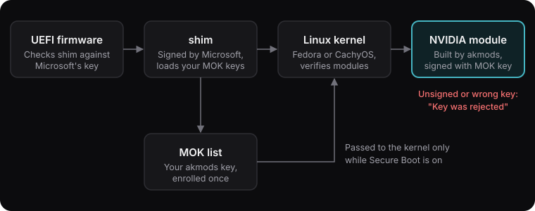

<!-- markdownlint-disable MD014 -- "$ " prompts drive the terminal styling in blog.js -->

With Secure Boot on, Fedora only loads the NVIDIA driver if it is signed by a key you enrolled in the MOK list. I set that up in [[cachyos-kernel-on-fedora]]. Over a few months on my ROG laptop ([[fedora-on-rog-strix-g16]]), that chain broke three times. Each time the symptom looked like a driver problem, and each time the cause was the signature.

## The chain, in one line

`akmods` builds the NVIDIA module and signs it with `/etc/pki/akmods/private/private_key.priv`. You enrolled the matching public key (`public_key.der`) in MOK. shim passes MOK keys to the kernel **only while Secure Boot is on**. The kernel then checks the module's signature against them.



If any link breaks, the kernel refuses the driver:

- The module is unsigned.
- The module is signed with a key you never enrolled.
- Secure Boot is off, but the kernel is still locked down.

## First checks

Run these before changing anything:

```bash
$ mokutil --sb-state
SecureBoot enabled
$ modinfo -F signer nvidia
myhost_1700000000_a1b2c3d4
$ sudo modprobe nvidia
$ sudo dmesg | grep -i -E "nvidia|rejected|unsigned" | tail
```

- No signer line means the module is unsigned.
- A signer that isn't in `mokutil --list-enrolled` means the wrong key.
- `Key was rejected by service` from `modprobe` can mean either of these.

## Incident 1: I turned Secure Boot off and NVIDIA died

I switched Secure Boot off in the BIOS, thinking it would make things simpler. After that:

```bash
$ sudo modprobe nvidia
modprobe: ERROR: could not insert 'nvidia': Operation not permitted
```

**Cause:** my kernel command line still had `lockdown=integrity`. Lockdown kept enforcing module signatures, but with Secure Boot off, shim no longer loaded my MOK key. So the akmods-signed module could no longer be verified.

**Fix:** change Secure Boot and lockdown together. Either remove `lockdown=integrity` from `GRUB_CMDLINE_LINUX` in `/etc/default/grub` and regenerate GRUB:

```bash
$ sudoedit /etc/default/grub
$ sudo grub2-mkconfig -o /boot/grub2/grub.cfg
```

Or, simpler, turn Secure Boot back on. In the end I did both: lockdown came off the command line, and Secure Boot went back on.

## Incident 2: after the Fedora 44 upgrade, "Key was rejected"

After upgrading from Fedora 43 to 44, the GPU fell back to nouveau. I did a clean reinstall of the driver from RPM Fusion, which brought in 595.71.05, and rebooted:

```bash
$ sudo modprobe nvidia
modprobe: ERROR: could not insert 'nvidia': Key was rejected by service
```

Everything else looked right:

```bash
$ mokutil --sb-state
SecureBoot enabled
$ sudo kmodgenca -a
EXISTING KEY PAIR
$ sudo mokutil --import /etc/pki/akmods/certs/public_key.der
SKIP: /etc/pki/akmods/certs/public_key.der is already enrolled
$ modinfo nvidia | grep sig
```

The last command printed nothing: the module was **unsigned**. Signing it by hand with the kernel's `sign-file` tool failed with `xz: File is corrupt`, so the build itself was broken.

**The fix that worked** was to throw away the cached build and let akmods start over:

```bash
$ sudo dnf remove akmod-nvidia 'kmod-nvidia*'
$ sudo rm -rf /var/cache/akmods/nvidia*
$ sudo dnf install akmod-nvidia xorg-x11-drv-nvidia-cuda
$ sudo akmods --force --rebuild
$ sudo dracut --force
$ sudo reboot
```

After the reboot, `modinfo nvidia` showed my key as the signer again.

Removing `akmod-nvidia` also removes the CUDA userspace, which includes `nvidia-smi`. That's why `xorg-x11-drv-nvidia-cuda` is in the install line above. I forgot it the first time and lost `nvidia-smi`.

This purge-and-rebuild is now my standard fix whenever NVIDIA won't load after a new kernel or a Fedora upgrade.

## Incident 3: an out-of-tree DKMS driver (OpenRazer)

OpenRazer builds its modules with DKMS, not akmods. DKMS has its own key (`/var/lib/dkms/mok.pub`). Under Secure Boot its modules were rejected, so I tried signing them by hand with the kernel's `sign-file` script, the same way as in incident 2.

That corrupted the modules (`zstd: Src size is incorrect`). Fedora ships modules compressed as `.ko.xz` or `.ko.zst`, and `sign-file` appends a signature to the **compressed** file, which breaks it.

Enrolling the DKMS key and rebuilding still left `modprobe` failing with `Key was rejected`. I was offered `module.sig_enforce=0` or turning off validation, and said no. I kept Secure Boot on and removed OpenRazer instead.

## Rules I follow now

- **Don't run `sign-file` on `.ko.xz` or `.ko.zst` files.** Let akmods or DKMS sign. If a module is unsigned, rebuild it.
- **Don't run `kmodgenca --force`** unless you are going to enrol the new key. Otherwise every new build is signed with a key the kernel rejects.
- **Change Secure Boot and `lockdown` together**, or just leave Secure Boot on.
- **After a Fedora version upgrade, check NVIDIA before anything else:** `modinfo -F signer nvidia`, then `nvidia-smi`.
- **Clean up old keys occasionally.** Look with `mokutil --list-enrolled`. Remove one with `sudo mokutil --delete <file.der>` and confirm at the next boot, the same way you enrolled it.

## The whole procedure, copy-ready

```bash
# One time: tools and a signing key
$ sudo dnf install akmods mokutil openssl kmodtool
$ sudo kmodgenca -a
$ sudo mokutil --import /etc/pki/akmods/certs/public_key.der
# Reboot -> MOK Manager: Enroll MOK -> Continue -> Yes -> password -> Reboot

# Whenever NVIDIA won't load (new kernel, Fedora upgrade)
$ sudo dnf remove akmod-nvidia 'kmod-nvidia*'
$ sudo rm -rf /var/cache/akmods/nvidia*
$ sudo dnf install akmod-nvidia xorg-x11-drv-nvidia-cuda
$ sudo akmods --force --rebuild
$ sudo dracut --force
$ sudo reboot

# Check
$ mokutil --sb-state
$ modinfo -F signer nvidia
$ nvidia-smi
```

The Copy button on that block copies only the commands, so it is safe to paste.
